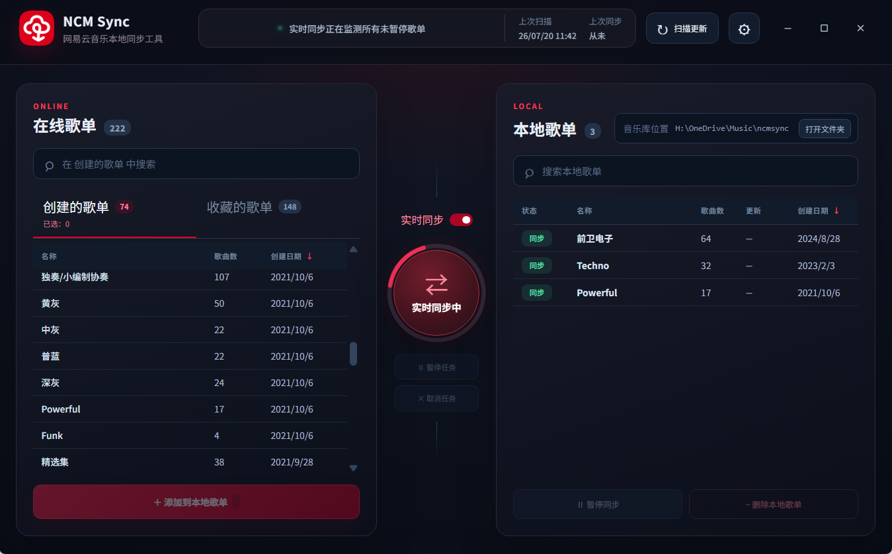

<p align="center">
  
</p>

<h1 align="center">NCM Sync</h1>

<p align="center">将网易云音乐在线歌单实时同步到本地音乐库。</p>

<p align="center">
  <a href="../../releases/latest">下载最新版</a> ·
  <a href="#快速开始">快速开始</a> ·
  <a href="PRIVACY.md">隐私说明</a> ·
  <a href="SECURITY.md">安全策略</a> ·
  <a href="CONTRIBUTING.md">参与贡献</a>
</p>

- 歌单更新了，但是忘记更新了哪几首，总是重复下载整个歌单？
- 整理完在线歌单，还要在本地再整理一次？
- DJ时想快速从网易云抓歌，下载导入困难重重？

**使用NCM Sync让你的本地音乐库拥有在线服务般的体验！**



## 为什么使用 NCM Sync

NCM Sync 面向需要把网易云音乐歌单整理为本地文件夹的用户，尤其适合DJ等依赖本地音乐库且对实时性有要求的用户。

- 多种同步模式：实时同步、定时同步、手动一键同步。
- 快速检索用户创建和收藏的公开歌单
- 增量新增，仅下载真正缺少的歌曲，不重复下载。
- 同一歌曲出现在多个歌单，不重复占用空间，歌单文件夹优先使用 NTFS 硬链接，歌曲实体集中保存在 `songs/`；当同步删除或删除本地歌单使歌曲不再属于任何本地歌单时，会自动清理实体文件。
- 通过复选框明确选择同步歌单，只匹配所选歌单的同名现有目录；也可手动指定一对一映射。
- 左侧在线、右侧本地的两栏歌曲对照，复选框全选、紧凑单行、整行背景区分已有和未下载，支持拖拽、撤回和重做。
- 本地栏与歌曲数按映射文件夹中的全部直属音频显示，包含未匹配在线歌单的文件；这类歌曲以原文件名标识，默认留存，只有明确选择删除并执行同步才会移除。
- MP3 导出支持保留源音质或 128 / 192 / 256 / 320 kbps 固定码率，内置编码器，仅处理新下载歌曲。
- 多线程高速下载，并在失败后安全暂停。
- 完整处理数千首歌的超大歌单。
- 内置 NCM 格式转换。

## 系统要求

- Windows 10 或 Windows 11，64 位。
- 建议将音乐库存放在 NTFS 分区，以获得硬链接去重效果；跨文件系统时会安全回退为复制。
- 受限音源需要用户自己的网易云音乐登录状态和相应内容访问权限。

## 安装

1. 在仓库右侧的 **Releases** 中下载 `NCMSync-<版本>-Setup.exe`。
2. 运行安装程序并选择安装位置。
3. 首次启动后输入网易云用户 ID，或使用“一键获取 ID 和 Cookie”完成登录。
4. 选择音乐库位置，勾选需要同步的歌单，再匹配或映射现有本地目录。

当前公开安装包未进行商业代码签名。Windows 可能显示 SmartScreen“无法识别的应用”提示；为避免潜在风险，请只从本仓库的 Releases 下载。

## 快速开始

1. 首次运行选择音乐库位置并填写网易云用户 ID。首次设置只读取歌单列表，默认没有勾选任何歌单。

2. 使用左侧复选框勾选同步范围，可“全选当前列表”“取消全选”或“清空选择”。点击“匹配所选歌单的现有目录”查看映射，或使用“自定义映射到本地文件夹”。找不到目录时不会自动创建文件夹。

3. 双击已映射歌单，勾选参与同步的歌曲并保存。点击“同步所选”检查差异并处理勾选歌单。“刷新歌单”只更新在线列表，“扫描更新”只检查勾选歌单的本地差异。

### 子目录识别与自定义映射

同名目录优先从音乐库第一层识别；第一层没有时，会递归寻找唯一的同名子目录。遇到多个同名目录或多个同名在线歌单时，不会自动选择不确定的对应关系。`songs/`、`.cloudmusic/` 和符号链接、目录联接不参与识别。

选择一个在线歌单，点击“自定义映射到本地文件夹”，即可指定音乐库内任意层级、任意名称的现有文件夹；点击“使用音乐库文件夹”可直接映射音乐库根目录。本地歌单显示完整路径，可点击“修改映射”调整。一份在线歌单只对应一个本地目录，同一目录不能重复映射。父、子文件夹可以分别映射，每个歌单只管理对应目录的直属音频。手动映射的目录不会随在线歌单改名自动重命名；重新映射会保留原目录的文件，在新目录重新识别歌曲。

删除普通本地歌单只删除直属音频，保留子文件夹及其他文件，目录为空时才一并移除；该歌单也会退出同步范围，避免保留目录被自动重新映射。父目录包含子文件夹时，同步文件夹名称只移动父歌单的直属音频，子歌单仍使用原路径；仅本地歌曲的选择会保留。迁移整个音乐库时，父子目录只搬运一次，各映射继续使用原来的相对路径。

移除根目录歌单时只移除映射，保留根目录中的全部文件；逐曲删除仍只作用于明确选择的歌曲。迁移根目录歌单时只迁移已管理歌曲，不移动无关文件和子目录。

手动、启动、定时和实时扫描及同步都只处理左侧勾选的歌单。选择保存在本机，未勾选歌单不会自动识别、扫描或下载。同步前复核一对一映射和现有目录；目录丢失时不会重建目录。更换网易云账号后清空同步范围，需重新勾选。

### 逐曲管理与撤回

双击本地歌单或已映射的在线歌单打开两栏对照：左边是在线歌单，右边是本地已有歌曲。勾选参与同步，取消勾选保持原样；上方和每栏的“全选”都是复选框，取消勾选即可取消全选。歌曲固定在各自列表中，紧凑单行显示名称、歌手和时长；整行绿色背景表示本地已有，棕色背景表示尚未下载，文字同时说明状态。

点击歌曲行的名称、歌手、时长等任意位置即可切换勾选。按住 Shift 点击另一首，会把从上次点击到当前歌曲的一段统一设为起点的勾选或取消状态，支持跨页；左右列表分别记录起点，整段操作可一次撤回。歌曲旁的复选框也支持 Shift；“删除”按钮独立操作，不会额外切换勾选。

未勾选歌曲不下载、不删除、不补写封面。右栏的“删除”明确安排删除对应本地链接，红色背景表示待删除，再点“留存”取消删除。拖拽到右栏可勾选歌曲，从右栏拖到左栏可取消选择并保留本地文件；列表始终反映在线内容和本地实际内容。

逐曲选择只作用于当前歌单，并覆盖全局删除设置；方案会保存到本机数据库，重新扫描和重启后仍然有效。在线减少的歌曲默认留存，除非开启全局删除或逐曲选择删除。

“撤回”和“重做”支持 `Ctrl+Z`、`Ctrl+Shift+Z` / `Ctrl+Y`。**撤回修改的是同步方案，已同步执行的文件操作不能撤回。** “应用方案”保存所有歌曲的完整选择，包括未勾选状态，不立即修改音乐文件；可继续撤回并再次应用。关闭时尚未应用的修改会提示确认丢弃。“应用并同步”先保存方案，再仅同步当前歌单。扫描或同步任务进行时暂时不能编辑。

超大歌单的编辑器按每页 100 首显示，每页只渲染可见歌曲和少量预留行；在线歌单表和歌曲预览也采用可视区域渲染。全选、搜索、Shift 连选和保存仍作用于完整列表。拖拽悬停不重算整张歌单。

主界面轮询只传输歌单摘要，完整曲目在打开详情时按需读取；未变化的摘要返回 HTTP 304 并复用界面状态。任务中快速更新，空闲时降低频率，窗口隐藏时停止轮询，重新显示时立即刷新。后台逐歌单复用未改变的曲目快照，并将新歌曲及其歌单关系一起持久化，减少重复整库写入。

开发者可用 `npm.cmd run profile:performance` 在模拟账号和临时音乐库上重现长列表滚动/拖拽测试，输出脚本耗时、布局耗时、帧间隔及 DOM 行数；不会操作当前音乐库。

### MP3 导出码率

设置中的“MP3 导出码率”提供保留源音质（默认，MP3 / FLAC）和 128、192、256、320 kbps。固定码率会将之后新下载的音频、包括解码后的 NCM/FLAC，实际转换为 MP3；内置 FFmpeg 编码器，无需安装额外程序。

本地已有或共享实体的歌曲直接复用，未勾选歌曲保持原样，不会因更改码率重新编码。一个同步任务使用启动时的码率，任务中更改设置从下一次任务生效。取消任务会终止编码并清理暂存文件；转码失败保留源文件供重试。提高码率不会提升原始音源音质。

### 定时同步

在设置中打开“自动扫描”并设置扫描周期，并打开“扫描完成后立即同步”。只对已勾选歌单按周期检查和同步。

### 实时同步

打开“同步所选”上方的“实时同步”开关后，应用会持续监测勾选歌单，仅下载其中参与同步的新增歌曲。

*DJ时想快速加歌？在DJ软件中打开歌曲库，打开手机或电脑的网易云，直接将需要的歌曲收藏到实时同步中的歌单，10秒后歌曲就会出现在DJ软件中！*

### 暂停同步

选择你希望暂停同步的本地歌单，点击“暂停同步”，之后该文件夹将不会参与任何同步任务。

### 离线

当本地歌单检测不到对应的在线歌单时（比如在线歌单被删除或本地歌单被重命名），该本地歌单会处于“离线”状态。你可以右键-“重定向到在线歌单”与选择的在线歌单重新建立同步。

### 登录、Cookie 与受限音源

应用可以打开隔离、沙箱化的网易云音乐登录窗口，只读取登录成功后的 `MUSIC_U` Cookie。Cookie 默认隐藏，仅保存在音乐库的 `.cloudmusic/cloudmusic.sqlite` 中，不会上传到 NCM Sync 的服务器——本项目没有遥测或云端服务。

请勿分享 `.cloudmusic` 目录、数据库或 Cookie。重新获取 Cookie 后，因权限问题暂停的当前下载任务会自动继续。

## 音乐库结构

```text
Music Library/
├─ .cloudmusic/cloudmusic.sqlite  # 本机配置、映射与任务状态
├─ songs/                         # 唯一歌曲实体
├─ 歌单 A/                        # 指向 songs/ 的硬链接
└─ 歌单 B/
```

开启“同步时一并删除减少的歌曲”后，移除歌曲会同步删除对应本地链接；移除本地歌单也会删除其链接。NCM Sync 会保留仍被其他本地歌单引用的共享歌曲，只有歌曲不再属于任何本地歌单时，才会清理 `songs/` 中的实体文件。修改音乐库位置时，可以选择迁移现有内容，或保留旧文件并在新位置重新识别、同步。

## 从源码运行

需要 Node.js 22.12 或更高版本。PowerShell 建议使用 `.cmd` 入口：

```powershell
git clone <本仓库地址>
cd NCM-Sync
npm.cmd ci
npm.cmd run dev
```

开发模式的 Electron 用户数据和缓存保存在仓库内的 `.cloudmusic/electron-dev/`，不会使用正式版的 AppData 数据。

### 测试

```powershell
npm.cmd test
npm.cmd run test:e2e
```

测试全部使用模拟接口和临时音乐库，不会接触真实账号、Cookie 或现有音乐文件。

### 构建 Windows 安装包

```powershell
npm.cmd run dist
npm.cmd run test:packaged
```

输出位于 `release/`。构建产物、音乐库、Cookie 和下载文件均被排除在 Git 跟踪之外。

## 隐私与安全

- 不收集遥测，不提供远程账号系统，也不运行 NCM Sync 云端服务。
- 主窗口启用 Electron 沙箱、上下文隔离和受限 preload API。
- 本地 HTTP API 只监听 `127.0.0.1`，并拒绝非应用来源的写操作。
- 网易云登录窗口限制为网易云音乐 HTTPS 域名。
- 完整的数据处理说明见 [PRIVACY.md](PRIVACY.md)。
- 安全问题请按 [SECURITY.md](SECURITY.md) 私下报告，不要在公开 Issue 中披露 Cookie 或可利用细节。

## 免责声明

NCM Sync 是独立的开源项目，与网易云音乐及其关联公司无隶属、授权或认可关系。网易云音乐名称及相关商标归其权利人所有。

本工具只应处理用户依法获得访问权限的内容。用户应自行遵守适用法律、平台规则和内容许可，不得使用本工具传播、出售或侵犯第三方版权。项目不提供账号、会员权限或内容访问权。

## 贡献与许可

欢迎提交问题和改进。开始贡献前请阅读 [CONTRIBUTING.md](CONTRIBUTING.md)。

源代码采用 [GNU GPL v3.0](LICENSE)（GPL-3.0-only）。NCM 格式兼容实现及其他第三方组件的声明见 [THIRD_PARTY_NOTICES.md](THIRD_PARTY_NOTICES.md)。
